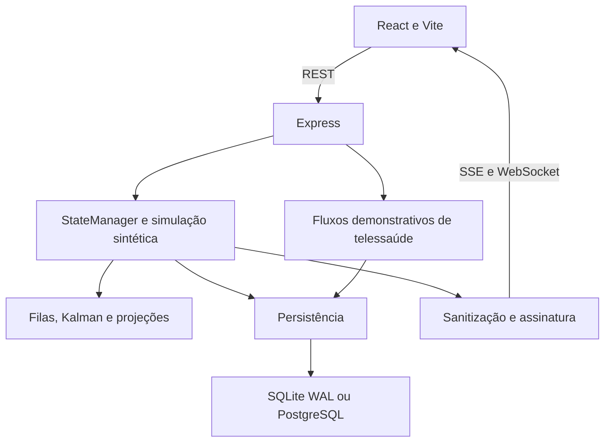

# Arquitetura implementada e arquitetura proposta

Revisão: 03/11/2026. Base de leitura: 67ff4a5. Descrição estática do protótipo; não é evidência de implantação ou de integração em campo.

## Implementado

O servidor também pode servir o frontend compilado. O mapa usa Leaflet e tiles externos. A persistência guarda snapshots, eventos e registros demonstrativos; consulta de histórico permite gráficos locais. Os exemplos FHIR são prévias de coleção agregada, não submissões homologadas à RNDS.

Não há conexão operacional com prontuário, SISREG, RNDS, Redis, LiveKit, SMS, WhatsApp ou ICP-Brasil comprovada pela presença de arquivos de configuração. Docker Compose declarar serviços não demonstra que o backend os utiliza.

## Fronteiras atuais

REST, SSE e WebSocket precisam de autenticação/autorização antes de dados privados. O bloqueio de duas rotas clínicas em produção não cobre todas as leituras e alterações. Os estados continuam sendo gerados por demonstração.

Assinatura Ed25519 assegura correspondência entre conteúdo e chave fornecida; identidade do emissor e confiança na chave precisam de processo próprio. A chave é gerada por instância no serviço atual.

A extensão HL7 de demonstração deve ser avaliada pelo que o coletor e seus testes efetivamente tratam. Não presumir serviço MLLP, cobertura de todo HL7 ou contrato com fornecedor.

## Próxima arquitetura

Preservar o monólito e adicionar uma fronteira de ingestão autorizada com validação, idempotência, reconciliação, controle de acesso e qualidade. Separar eventos internos da projeção pública. A proposta detalhada, contrato de dados e lacunas estão em [dados e governança](planejamento/06_DADOS_ARQUITETURA_GOVERNANCA.md); execução no [backlog](planejamento/04_BACKLOG_PRIORIZADO.md).

As decisões dependem de volume, equipe, acesso e requisitos do parceiro. Não implantar microsserviços ou cache distribuído sem necessidade medida.
