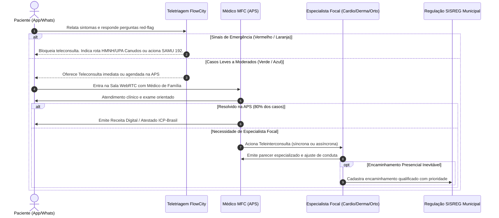

# FlowCity Saúde — Conformidade com a Resolução CFM nº 2.314/2022 & Protocolos de Teleinterconsulta

Este documento estabelece as diretrizes normativas e operacionais para os módulos de **Teletriagem**, **Teleconsulta da Atenção Primária** e **Teleinterconsulta com Especialistas** no âmbito da rede pública municipal de saúde.

---

## 1. Enquadramento Normativo (Resolução CFM nº 2.314/2022)

A Resolução CFM nº 2.314/2022 define as modalidades de telemedicina no Brasil:

1. **Teletriagem Médica (Art. 7º):** Avaliação prévia de sintomas com classificação de risco clínico, determinando a urgência do atendimento ou o direcionamento para o nível de atenção mais adequado.
2. **Teleconsulta (Art. 5º):** Consulta médica remota realizada entre médico e paciente mediada por tecnologias de comunicação síncronas (áudio e vídeo).
3. **Teleinterconsulta (Art. 6º):** Troca de informações e opiniões entre médicos (médico assistente e médico especialista), com ou sem a presença do paciente, para auxílio diagnóstico ou terapêutico.
4. **Telemonitoramento (Art. 8º):** Acompanhamento à distância de parâmetros de saúde e doença sob supervisão médica.

---

## 2. Fluxo Clínico Integrado no FlowCity Saúde

---

## 3. Diretrizes de Segurança e Prontuário Eletrônico

* **Consentimento Esclarecido:** O paciente registra consentimento eletrônico explícito antes de entrar na sala de teleconsulta.
* **Assinatura Digital:** Todas as receitas, atestados e pareceres especializados são assinados utilizando certificados digitais no padrão da Infraestrutura de Chaves Públicas Brasileira (**ICP-Brasil**).
* **Guarda de Registros:** Os dados da teleconsulta são integrados ao prontuário eletrônico do e-SUS PEC ou HIS municipal, atendendo ao prazo de guarda mínimo de 20 anos estabelecido na Lei nº 13.787/2018.
