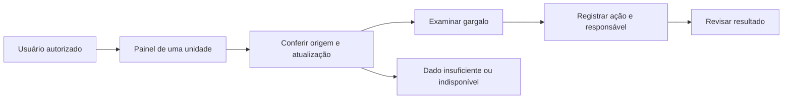

# PRD — FlowCity Observação de Fluxo

Proposta 0.1, 03/11/2026. Requisitos futuros, sujeitos à descoberta. [Estado atual](../STATUS_DO_PROJETO.md).

## 1. Resumo

Construir uma versão interna que mostre situação e qualidade dos dados de um fluxo em uma unidade de saúde. O gestor deve conferir a origem, identificar um gargalo, registrar uma ação e acompanhar sua evolução. Validar utilidade antes de publicar estimativas ao cidadão ou ampliar módulos clínicos.

## 2. Contatos

| Papel | Responsabilidade | Situação |
| --- | --- | --- |
| Alex, proponente | Produto e organização da validação | Identificado na conversa; dedicação a confirmar |
| Patrocinador da instituição | Viabilizar piloto e decisão operacional | A designar pelo parceiro |
| Gestor/NIR | Definir processo, indicador e ação | A designar |
| TI/fornecedor da origem | Autorizar e manter integração | A designar |
| Encarregado, jurídico e segurança | Definir responsabilidades e proteção de dados | A designar |
| Engenharia e dados | Construir e medir | Equipe não confirmada |

Papéis municipais só passam a valer quando formalizados; nenhum parceiro está presumido.

## 3. Contexto

Há interface, simulação e persistência, mas ainda falta demonstrar valor em processo real. Já existem soluções públicas de regulação e gestão; a oportunidade depende de uma lacuna local. A primeira tarefa é identificar essa lacuna e conseguir dados verificáveis.

## 4. Objetivo e resultados

**Objetivo:** em um ciclo proposto de 16 semanas, produzir evidências para decidir se o FlowCity merece um piloto ampliado.

Metas propostas, a pactuar até a semana 2:

- S2: 12 entrevistas em pelo menos quatro papéis; um problema recorrente, uma decisão e seu responsável selecionados.
- S8: quatro semanas de dados autorizados; pelo menos 95% de completude dos campos necessários e no máximo 2% de episódios avaliáveis com erro de ordem temporal.
- S12: avaliação temporal da previsão contra uma referência simples, com relatório por período e grupo com amostra suficiente.
- S16: pelo menos quatro dos cinco gestores participantes concluem as tarefas centrais sem ajuda; decisão documentada de continuar, ajustar ou encerrar.

São metas de desenho, não padrões clínicos nem resultados observados. Revisões devem ocorrer antes da avaliação e ficar registradas. Redução de espera será exploratória, conforme desenho do piloto.

## 5. Segmentos

**Principal:** gestor de turno/NIR que precisa conhecer gargalos e confiar na informação. **Secundário:** TI que mantém a fonte e detecta perdas e atrasos. **Beneficiários indiretos:** equipe e usuários do serviço.

Restrições: pouco tempo de treinamento, conectividade variável, nenhuma duplicação de prontuário e nenhuma nova tarefa assistencial só para alimentar o painel.

## 6. Proposta de valor

Reduzir o esforço de reunir informação e tornar visíveis os limites dos dados. O gestor deve conseguir explicar de onde veio um número, quando foi atualizado e qual ação foi registrada. O diferencial a provar é uma rotina útil com integração confiável.

## 7. Solução

### 7.1 Experiência

Oferecer alternativa textual aos gráficos, acesso por teclado e motivo visível da indisponibilidade. Alertas apoiam revisão humana.

### 7.2 Funções essenciais

Autenticação e permissões por unidade; separação entre dados sintéticos e reais; conector autorizado com idempotência; qualidade e origem visíveis; tempos observados por etapa; registro de ações; comparação experimental de previsão; trilha de acesso; backup e restauração. [Aceites detalhados](04_BACKLOG_PRIORIZADO.md).

### 7.3 Tecnologia

Manter o monólito até haver necessidade medida de separação. Eventos autorizados passam por validação interna e geram agregados. A integração RNDS não é dependência desse primeiro recorte. [Dados e arquitetura](06_DADOS_ARQUITETURA_GOVERNANCA.md).

### 7.4 Suposições

Há horários confiáveis, acesso autorizado, responsável capaz de agir e benefício sem trabalho duplicado. Confirmar cada hipótese. Triagem automática, prescrição, teleconsulta real e destino de ambulância exigem projetos próprios.

## 8. Entrega

S1–2: descoberta. S3–4: proteção e contrato. S5–8: ingestão e linha de base. S9–12: avaliação silenciosa. S13–16: uso interno assistido e decisão. A janela é estimativa, dependente dos [marcos de avanço](03_ROADMAP_CRONOGRAMA.md).
