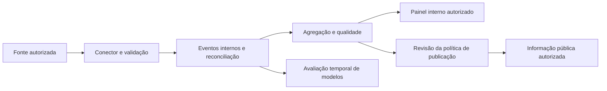

# Dados, arquitetura e governança

Revisão de leitura do código em 03/11/2026, base 67ff4a5. Os achados são revisão estática; não houve pentest, auditoria LGPD nem certificação de conformidade.

## Situação observada e trabalho necessário

| Componente | Estado observado | Evolução proposta |
| --- | --- | --- |
| Modo de dados | StateManager inicializa estados e ticker sintéticos | Separação explícita de ambientes e bloqueio do ticker com ingestão institucional |
| Acesso | Roteador REST sem autenticação por usuário/unidade; SSE/WS também precisam de política | Autenticação, autorização em toda leitura/escrita privada e isolamento |
| Fluxos clínicos | SOAP/criação de encaminhamento bloqueados em produção; outras rotas de consulta e alteração continuam expostas no roteador | Inventariar todos os caminhos; bloqueio parcial não constitui fronteira de segurança |
| Persistência | PostgreSQL com retorno ao SQLite em falha; WAL no SQLite | Política explícita de falha, readiness e recuperação em produção |
| Assinatura | Novo par de chaves por instância; JSON.stringify para serializar | Origem confiável, identificador, proteção, rotação e serialização estável |
| Publicação | Supressão de células menores que 3 em várias saídas | Verificar composição de totais, cortes temporais e todos os endpoints, inclusive rota e previsão |
| Cabeçalhos/limites | Helmet, CSP desligada, CORS aberto e limite REST por processo | Política de origem, CSP validada e limites compartilhados, além de proteção de conexões |
| API/implantação | Metadados OpenAPI reduzidos e documentos separados; paths do frontend dependem do layout | Contrato verificável e teste da imagem/container antes de uso institucional |

Referências de implementação: [servidor](../../backend/src/server.ts), [rotas](../../backend/src/routes/api.ts), [privacidade](../../backend/src/services/privacy.ts), [assinatura](../../backend/src/services/signer.ts), [persistência](../../backend/src/services/persistence.ts). Aceites no [backlog](04_BACKLOG_PRIORIZADO.md).

## Arquitetura proposta

A informação pública é uma projeção separada. Não expor diretamente banco de eventos ou formulários clínicos. A primeira hipótese pode ser demonstrada sem construir um novo prontuário.

## Contrato mínimo de evento — proposta

| Campo | Finalidade |
| --- | --- |
| event_id e source_system | Idempotência e identificação da origem |
| unit_id e tipo do evento | Vincular unidade/etapa validadas |
| occurred_at e received_at | Separar ocorrência de ingestão; UTC com timezone de exibição definido |
| schema_version | Validar mudanças do contrato |
| episode_token, se indispensável | Conciliar etapas internamente, sob política e retenção próprias |
| quality_flags | Informar ausência, atraso, correção e erro |
| source_revision/correction_of | Tratar atualização e correção sem dupla contagem |

Episode_token pseudonimizado ainda pode ser dado pessoal. Se for possível receber somente agregados adequados à pergunta, preferir essa opção. Não capturar nome, CPF, CNS, telefone ou texto clínico para o painel de fluxo. Não manter mensagem bruta como log por conveniência.

Regras necessárias: deduplicação, eventos fora de ordem, reenvio, correção, reconciliação com total da origem, relógios, fuso e definição de encerramento. Uma falha na origem deve ser visível; um dado ausente nunca vira zero.

## Limites da supressão atual

Ocultar contagens 1 e 2 reduz exposição de pequenas células, mas não demonstra anonimização. Totais e outras células podem permitir dedução; consultas sucessivas podem revelar mudanças de um indivíduo. Histórico, exportação, rota, previsão, FHIR e fluxo em tempo real precisam de análise conjunta. Isso é uma hipótese de risco identificada no desenho, não relato de exploração realizada.

Propostas: supressão complementar, janelas mínimas, limitação de cortes, atraso de divulgação, testes de reconstrução e aprovação da política de publicação. Não escolher k nem ruído estatístico como garantia universal. [LGPD atualizada](https://www2.camara.leg.br/legin/fed/lei/2018/lei-13709-14-agosto-2018-787077-normaatualizada-pl.html) e [guia da ANPD](https://www.gov.br/anpd/pt-br/centrais-de-conteudo/materiais-educativos-e-publicacoes/guia_orientativo_tratamento_de_dados_pessoais_pelo_poder_publico) orientam a revisão de finalidade, necessidade e responsabilidades.

## Decisões de governança que faltam

Definir controlador e operador pelo tratamento efetivo e instrumentos institucionais; não atribuir automaticamente esses papéis a uma secretaria. Pactuar finalidade, base legal aplicável, titularidade dos dados, acesso, retenção, direitos, incidentes, suboperadores e saída do fornecedor. ROPA e RIPD existentes eram textos de proposta, sem aprovação institucional.

Antes de dados reais: inventário, análise de risco, permissões, contratos necessários, teste de restauração e fluxo de resposta a incidente. Banco com trigger append-only não comprova inviolabilidade de auditoria nem impede ação de administrador privilegiado.

## Integrações e finalidade clínica

[RNDS](https://fhir.saude.gov.br/pt-BR/credenciamento.html) requer processo próprio e modelo compatível. CNES cadastral não é telemetria. Confirmar acesso e termos com fornecedor; evitar consulta direta ao banco de produção sem avaliação e autorização.

Qualquer evolução para triagem ou apoio diagnóstico/terapêutico exige reavaliar a finalidade pretendida e o enquadramento. A [orientação SaMD da Anvisa](https://www.gov.br/anvisa/pt-br/centraisdeconteudo/publicacoes/produtos-para-a-saude/manuais/software-como-dispositivo-medico-perguntas-e-respostas) é referência para essa análise; não determina, por si, a classificação do FlowCity. Telessaúde exige revisão específica dos responsáveis e do serviço.

## Rotina mínima de operação proposta

Responsável por ingestão e responsável pelo painel; monitoramento de atraso e cobertura; backup e restauração verificada; política de mudança; revisão de acessos; registro de incidentes e treinamento para usar o processo habitual em falha. Definir SLOs após medir a fonte, com metas, janela e responsável.
